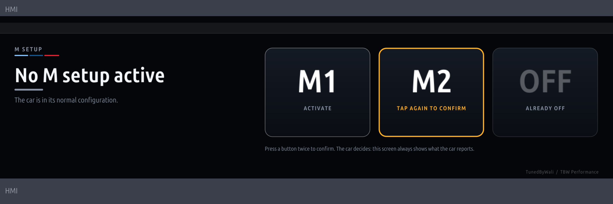

# TBW M Setup (BETA)

M1 / M2 from the iDrive 8 screen, for M cars whose steering wheel buttons are damaged. An app for the
[MGU Store](https://github.com/robertnisipeanu/mgu-store) by TunedByWali / TBW Performance (Built by Wali LLC).



> **Status: not car-tested, and the activation command is not included.** The app, its service, the Store packages
> and the status display are built and tested on a computer. What is missing is the one thing nobody has published:
> the SOME/IP call that makes a G8x car enter M1 / M2. Until a car's profile has it, the page shows the live M
> setup and its buttons stay off ("not set up"). See "Finding the command".

## What is in here

| Part | Id | What it does |
|---|---|---|
| App | `tbw_mdrive` | One page: the M setup the car reports (none / M1 / M2) and three buttons, M1, M2, Off. A button is pressed twice (the second press within 5 s confirms). Drawn through `mgu-render`. iDrive 8 only. |
| Service | `tbw-mdrive-d` | Root tool. Reads the car's M setup, sends this car's command when the app asks, then waits 4 s for the car to report the setup and says whether it did. |

The page always shows what the car reports, never what was asked for: a command the car ignores reads as
"sent, but the car did not report M1".

## Why not a CAN frame

The head unit's application processor has no CAN interface to write to. The car's buses end at the gateway (BDC),
and the head unit talks to the car over Ethernet with SOME/IP. The steering wheel's M buttons go the other way
round: wheel -> steering column switch cluster -> bus -> the unit that owns the M setups; the head unit only gets
the result. So the request has to be a SOME/IP call to the head unit's M Drive service (`0xB51F`), the service
its own M Setup menu uses. Sending a raw frame would need hardware on the bus itself.

What is known about that service (from IterioDev's Overlays tool, which reads it on G8x cars):

- notification `0x8018` byte 0: `0` no M setup, `1` M1, `2` M2 (a state)
- notification `0x8001` (older cars): one frame per M button action, byte 1 = `1` when the M buttons caused it

What is not known: a method that activates a setup. It may not exist. If it doesn't, the fallback is to apply the
same settings M1 holds one by one, as the HMI's Setup page does (engine, chassis, steering, brake, xDrive); DSC,
the gearbox's Drivelogic and the M Mode have their own buttons on the console and are unaffected by a broken wheel.

## Install

1. Root SSH on the head unit and the MGU Store installed (its README). Back up the coding first.
2. In the Store, add the source `IterioDev/car-apps` (channel Tags): the service uses the `hmictl` program its
   **Overlays** tool installs, and the Store installs Overlays with it. `hmictl` is IterioDev's (PolyForm Strict):
   it is not in this repository and not redistributed.
3. Add this repository as a source and pick **Releases**; install **M Setup**. Restart the head unit.

## Finding the command

Do this on a car with **working** M buttons first (parked, engine running, wheels on the ground, nobody near it).

1. Record what the service tells the head unit. Over SSH as root:
   ```sh
   echo '{"op":"discovery","on":true}' | socat - UNIX-CONNECT:/run/tbw-mdrive/ctl.sock
   tail -f /var/opt/tbw-mdrive/events.log
   ```
   Press M1, M2, leave; change single settings in the Setup menu. Each line is a notification that changed, with
   its bytes before and after. This shows which notifications carry the setup and the individual settings.
2. A notification `0x80NN` has a getter, method `0xNN` (Overlays reads `0x807C` with method 124). Setters and plain
   methods have their own ids, which SOME/IP does not list. They come from the HMI's generated interface code on the
   head unit (the M Drive proxy library the HMI loads); read the method ids there rather than trying ids on a car.
3. Try one call by hand, with the car reporting on the page:
   ```sh
   /var/opt/iteriodev-overlays/current/hmictl call 0xb51f 1 <method> 1 <hex payload>
   ```
4. When a call makes the car report M1, write it to `/var/opt/tbw-mdrive/profile.json`
   (`profile.example.json` beside the service shows the shape; root-owned, `chmod 600`):
   ```json
   { "version": 1, "note": "G82 2023", "commands": {
       "m1":  [ { "svc": "0xb51f", "inst": 1, "method": 30, "major": 1, "hex": "01" } ],
       "m2":  [ { "svc": "0xb51f", "inst": 1, "method": 30, "major": 1, "hex": "02" } ],
       "off": [ { "svc": "0xb51f", "inst": 1, "method": 30, "major": 1, "hex": "00" } ] } }
   ```
   (The numbers above are placeholders.) The service reads the file again within 5 s and the buttons light up.

**Do not scan method ids on a car.** A call nobody understands, sent to the drive-dynamics service, can change
stability, steering or brake settings. M1 can hold "DSC off".

## Safety and access

- The profile decides what is sent to the car, so only root can write it; the service ignores one that is not
  root-owned or is writable by others. Entries are checked (numbers and hex only, at most 8 calls of 64 bytes).
- The apps' socket (`/run/tbw-mdrive/ctl.sock`) is open to every app on the head unit and takes only: status,
  activate a setup the profile has, discovery on / off. It takes no raw calls.
- A setup the car already reports is not asked for again.
- Every request is in the journal: `journalctl -u tbw-mdrive-d`. Status: `node /var/opt/tbw-mdrive-d/current/mdrived.js status`.

## Build and test

```sh
MGU_STORE=<a clone of github.com/robertnisipeanu/mgu-store> tools/release.sh    # -> dist/release/
```

Runs the checks (the service against a stand-in for `hmictl`, the page's states, the app started against a fake
iDrive 8 HMI and renderer), builds the app and packs the catalog. Upload every file of `dist/release/` to a GitHub
release tagged `catalog`. `REPO=owner/name` sets where the catalog's download links point (default
`waliworld/MGU---MMode-Controller`). Page previews land in `dist/preview/`.

## Credits and licence

MIT ([LICENSE](LICENSE)). The app kit in `kit/` is the MGU App Kit from cauliflowermossgrape's idrive7-apps with the
iDrive 8 additions of JustAnotherPU's RideTube port (MIT, [kit/LICENSE](kit/LICENSE)). The M Drive notification
ids were first documented by IterioDev's Overlays tool. Not made or endorsed by BMW. Use at your own risk.
